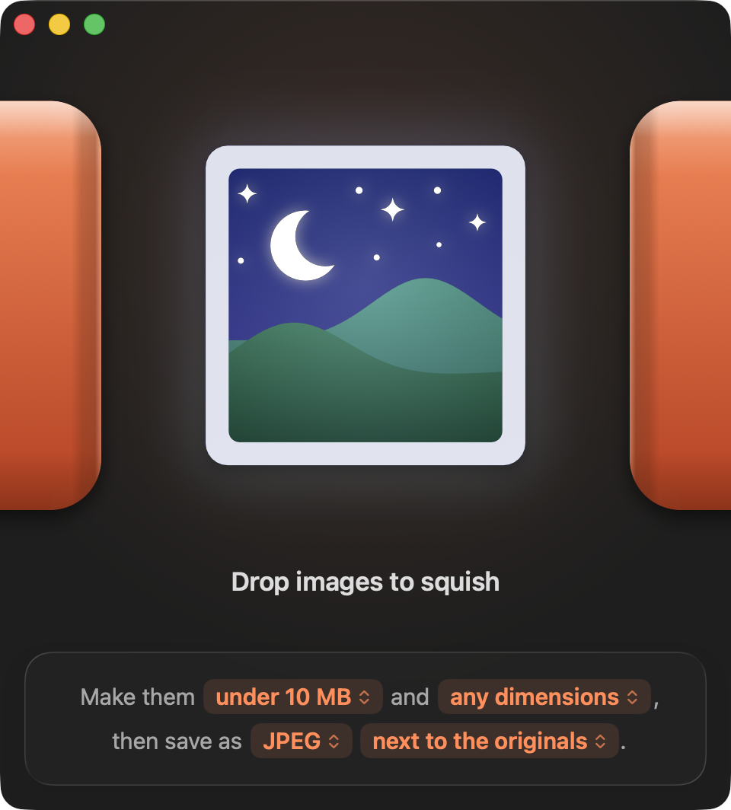

<p align="center">
  
</p>

<h1 align="center">Squish</h1>

<p align="center">
  Shrinks images to a file size, dimension limit, and format you choose.<br>
  Drop in files or folders; get JPEG or HEIC copies back.
</p>

<p align="center">
  
  
  
</p>

<p align="center">
  
</p>

## Features

- **Settings as pop-up menus:** file size, dimensions, format, and destination are each a pop-up menu in the window.
- **Sliders:** File size and Dimensions open on a slider. Dragging applies the value while the menu stays open.
- **File size presets:** Uploads 50 MB, Print 25 MB, Share 10 MB, Email 5 MB, Web 1 MB, Small 500 KB. Or drag to any limit, or pick no limit.
- **Dimension limits:** long side, width, or height, or **Fit Within a Box…** for both. Images are never upscaled.
- **Formats:** JPEG, or HEIC for smaller files on Apple devices. Reads anything ImageIO reads, including PNG and WebP.
- **Folders:** drop a folder and its structure is kept in the output.
- **Results list:** before and after size for each file. Drag rows into Mail or Slack, press Space for Quick Look, double-click to open.
- **Dock badge:** the icon badges and bounces when a batch finishes while you're in another app, with an optional sound.

## Install

Squish is not sandboxed and is not notarized, so you build it yourself. You need macOS 26 or later and Xcode 26 or later.

```sh
git clone https://github.com/dmccullum/Squish.git
cd Squish
./"Build Squish.command"
```

The script builds a Release copy, installs it to `/Applications`, registers the Finder service, and launches it. You can also open `Squish.xcodeproj` in Xcode and press Run, or build from the command line:

```sh
xcodebuild -project Squish.xcodeproj -scheme Squish -configuration Debug build
```

## Usage

Drop images or folders on the window or on Squish in the Dock. Other ways in:

- **⌘O** opens a file picker.
- **Squish Images** in Finder's Quick Actions and Services menu.
- **Open With** on any image or folder.

| Shortcut | Action |
| --- | --- |
| ⌘O | Choose images |
| ⌘↓ | Open the selected results |
| ⇧⌘R | Show results in Finder |
| Space or ⌘Y | Quick Look the selected result |
| ⌘C | Copy the selected results as files |
| Return or Esc | Clear the results (Done) |
| ⌘. | Stop the running batch |
| ⌘, | Settings |

The same choices are in the **Recipe** menu in the menu bar.

### Where files go

With **next to the originals**:

| You drop | Output |
| --- | --- |
| One image | `name (squished).jpg` beside it |
| Several items | A `Squished` folder in their common parent |
| A folder | A sibling `<name> (squished)` folder with the same structure |

With a chosen folder, everything goes there. Dropped folders keep their structure.

## How it works

- **File-size targeting** binary-searches encoder quality, then downscales if the lowest quality still overshoots.
- **Batches** either hit the target per image, or **match quality across the batch** (Settings): the quality that brings the heaviest image to the target is applied to all of them.
- If re-encoding would make a file larger, Squish keeps the original bytes.
- Images are processed concurrently across CPU cores. A failure affects only that file.
- **Settings** has the batch strategy, finish sound, and editable pixel-size and file-size presets.

## Project layout

| Path | Contents |
| --- | --- |
| `Squish/Core` | Image compression, job running, output paths |
| `Squish/Models` | Recipe, settings, drop input, results |
| `Squish/Views` | SwiftUI views and menus |
| `Config/Info.plist` | Document types and the Services entry |
| `Icon` | App icon sources (Icon Composer `.icon`, SVGs, generator scripts) |

New files under `Squish/` are picked up automatically by the Xcode project.

## License

[MIT](LICENSE)
